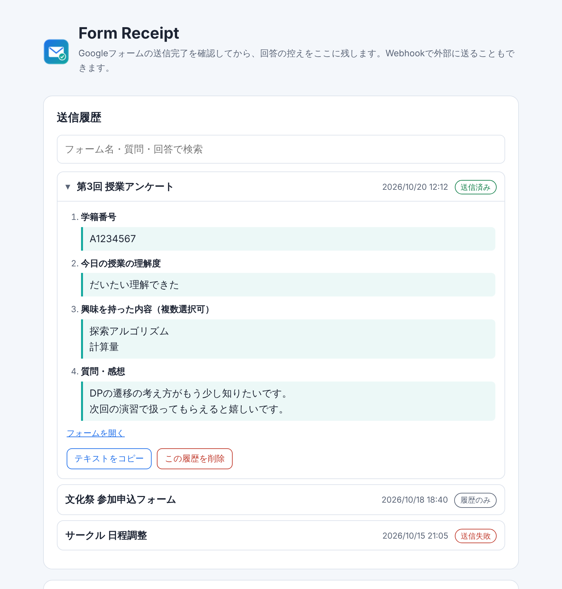

# Form Receipt

Googleフォームを送信したあと、**自分が何を回答したか**を残しておくための Chrome 拡張機能です。

- 送信完了画面が表示されたことを確認してから、質問と回答の控えを保存します
- 控えはブラウザ内の履歴に残り、あとから検索・コピーできます
- Webhookを設定すると、Discord・Slack などにも控えを送れます（スマホからも確認できます）
- フォームの作成者が「回答のコピーを送信」をオンにしていなくても使えます



## 対応ブラウザ

Chrome と、Brave・Edge など Chrome ベースのブラウザ（PC）。

## インストール

まだ Chrome ウェブストアには公開していないので、手動で読み込みます。

1. このページの緑色の **「Code」→「Download ZIP」** でダウンロードし、ZIPを展開します。
   展開したフォルダ（`FormReceipt-main`）は、消さない場所に置いてください。消すと拡張機能も動かなくなります。
2. ブラウザで拡張機能の管理画面を開きます。
   - Chrome：`chrome://extensions`
   - Brave：`brave://extensions`
   - Edge：`edge://extensions`
3. **デベロッパーモード** をオンにします（画面の右上、Edgeは左下）。
4. **「パッケージ化されていない拡張機能を読み込む」** を押し、展開したフォルダを選びます。
5. 設定画面が開けば完了です。ツールバーのアイコン（パズルのピースから固定できます）から、いつでも履歴と設定を開けます。

### アップデートするとき

新しいZIPをダウンロードして同じ場所に上書きし、拡張機能の管理画面で Form Receipt の 🔄（再読み込み）を押してください。履歴と設定はそのまま残ります。

## Webhookで送る設定（任意）

設定しなければ、履歴はブラウザ内にだけ残ります。

設定画面の「Webhook URL」にURLを貼り付けて保存し、「テスト送信」で届くか確認してください。保存するときに、送信先のサイトへのアクセス許可を求める画面が出ます。

送信先はURLから自動で判定します。

| 送信先 | 届く形 | URLの作り方 |
| --- | --- | --- |
| Discord | フォーム名・送信日時・質問と回答をまとめたカード | チャンネルの ⚙️「チャンネルの編集」→「連携サービス」→「ウェブフック」→「新しいウェブフック」→「ウェブフックURLをコピー」 |
| Slack | 見出し付きのメッセージ | Slack API の「Your Apps」でアプリを作成 →「Incoming Webhooks」をオン →「Add New Webhook to Workspace」 |
| Google Chat | テキストのメッセージ | スペースの名前 →「アプリと統合」→「Webhook を追加」（Google Workspace のアカウントが必要） |
| そのほか | JSON（下記） | Zapier・Make・n8n・自作のサーバーなど |

<details>
<summary>JSONの形式</summary>

```json
{
  "app": "Form Receipt",
  "version": "1.2.0",
  "type": "form_response",
  "form": { "title": "フォーム名", "url": "https://docs.google.com/forms/d/e/…/viewform" },
  "submittedAt": "2026-10-20T03:12:00.000Z",
  "answers": [
    { "question": "質問文", "values": ["回答"] }
  ],
  "text": "読みやすい形の全文"
}
```

テスト送信のときは `type` が `"test"` になります。`text` を表示する Mattermost などのサービスでは、そのまま読める形で届きます。
</details>

> Webhook URLを知っている人は、誰でもそこに送信できます。他人には教えないでください。

## データの扱い

- 回答の控えは、**あなたのブラウザ内**（`chrome.storage`）と、**あなたが設定したWebhook** にだけ保存・送信されます
- 開発者を含め、それ以外の場所には一切送信しません
- 動作するのは `docs.google.com/forms` の回答画面だけです（フォームの編集画面や、ほかのサイトでは動きません）

詳しくは [PRIVACY.md](PRIVACY.md) を見てください。

## 注意

- 拡張機能の使用が禁止されているテストや、ロックモードのフォームでは使わないでください（ロックモードでは拡張機能そのものが無効になります）
- 画面上の内容から回答を読み取っています。Googleフォームの画面構造が変わると、一部の回答をうまく読み取れなくなることがあります
- 記述式・段落・ラジオボタン（「その他」の記入を含む）・チェックボックス・プルダウン・均等目盛り・グリッド・日付・時刻・複数ページのフォームに対応しています。グリッドは「行：選んだ列」の形で保存します。ファイルのアップロードは読み取れません

うまく動かないときは、[Issues](../../issues) で教えてください。

## ライセンス

[MIT License](LICENSE)
